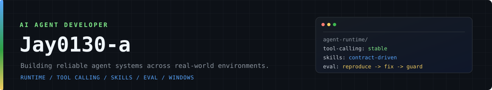

  
   
  
   
  
  
  
  
  

 

> AI Agent 方向开发者，关注 **Agent Runtime / Tool Calling / Skills / Eval**，以及跨平台（Windows）工程问题：路径、编码、shell 差异这类真实环境里才会暴露的坑。

---

## 开源贡献

> 当前记录 13 个已合并 PR，以及近期仍在评审中的贡献。状态更新于 2026-10-19。

### 已合并

| 项目 | 贡献 |
| --- | --- |
| `Tencent/teamai-cli` | [#1034](https://github.com/Tencent/teamai-cli/pull/1034) Windows hook 改为 PowerShell 语法 [#1046](https://github.com/Tencent/teamai-cli/pull/1046) 统一 `getUserHome()`，消除 Git Bash / PowerShell home 差异 [#1058](https://github.com/Tencent/teamai-cli/pull/1058) 新增 `teamai review` 只读健康检查 [#870](https://github.com/Tencent/teamai-cli/pull/870) Windows 临时根目录改用长路径 |
| `Tencent/WeKnora` | [#4374](https://github.com/Tencent/WeKnora/pull/4374) 拒绝旧版二进制 `.xls`，返回可操作错误 [#4425](https://github.com/Tencent/WeKnora/pull/4425) Helm data-files claim 访问模式改为可配置 [#4020](https://github.com/Tencent/WeKnora/pull/4020) 补齐 docreader 文本切分单测 |
| `QwenLM/qwen-code` | [#13960](https://github.com/QwenLM/qwen-code/pull/13960) 桌面版发布说明锚定到上一个桌面版本 |
| `bytedance/deer-flow` | [#7084](https://github.com/bytedance/deer-flow/pull/7084) DeerMem summary 可解析 UTF-8 BOM，不再误报损坏 [#7061](https://github.com/bytedance/deer-flow/pull/7061) `SOUL.md` 注入提示词前移除 BOM [#6984](https://github.com/bytedance/deer-flow/pull/6984) `SKILL.md` 的 BOM 不再进入模型上下文与指纹 [#6982](https://github.com/bytedance/deer-flow/pull/6982) 补齐 skillscan 解构绑定假阴性的回归固定 |
| `TencentCloud/octop-harness` | [#63](https://github.com/TencentCloud/octop-harness/pull/63) 子进程输出统一按 UTF-8 解码，不依赖宿主机 locale |

### 评审中

| 项目 | 贡献 |
| --- | --- |
| `QwenLM/qwen-code` | [#14431](https://github.com/QwenLM/qwen-code/pull/14431) 模型调用失败后不再重复提交 peer message [#14349](https://github.com/QwenLM/qwen-code/pull/14349) `/auth` 文案改为渲染期解析 [#14077](https://github.com/QwenLM/qwen-code/pull/14077) 重建 open-PR recheck workflow 的 Git 元数据 [#13962](https://github.com/QwenLM/qwen-code/pull/13962) ripgrep 回退提示收敛为可操作文案 [#13932](https://github.com/QwenLM/qwen-code/pull/13932) 按 150 字符预算分配索引标题 [#13897](https://github.com/QwenLM/qwen-code/pull/13897) 拒绝已停用的 Qwen OAuth 模型选择 |
| `bytedance/deer-flow` | [#7112](https://github.com/bytedance/deer-flow/pull/7112) 兼容运维侧 env / secret 文件的 UTF-8 BOM [#7110](https://github.com/bytedance/deer-flow/pull/7110) 快照文本缓存跨宿主按字节精确发布 |
| `TencentCloud/octop-harness` | [#81](https://github.com/TencentCloud/octop-harness/pull/81) bwrap 内绑定系统库所需的 `/etc` 路径 [#68](https://github.com/TencentCloud/octop-harness/pull/68) Kimi search 探测模型改为可配置 [#66](https://github.com/TencentCloud/octop-harness/pull/66) 将媒体指令限定到内置工具 |
| `QwenLM/Qwen-Agent` | [#997](https://github.com/QwenLM/Qwen-Agent/pull/997) `Storage.scan` key 统一为跨平台正斜杠 |
| `TencentCloud/Octop` | [#2179](https://github.com/TencentCloud/Octop/pull/2179) 请求或输入错误后释放半开 AUTO 探测 [#2105](https://github.com/TencentCloud/Octop/pull/2105) 工具开关关闭时保持媒体供应商弹窗可用 [#2063](https://github.com/TencentCloud/Octop/pull/2063) 不可用能力返回明确错误而非空上下文 [#2030](https://github.com/TencentCloud/Octop/pull/2030) Kimi 探测模型改为可配置 [#2029](https://github.com/TencentCloud/Octop/pull/2029) 仅在显式启用时挂载宿主 Docker socket [#2026](https://github.com/TencentCloud/Octop/pull/2026) 固定内置 Web 资源的 `Content-Type` [#1974](https://github.com/TencentCloud/Octop/pull/1974) gateway CLI 输出按 UTF-8 解码 [#1973](https://github.com/TencentCloud/Octop/pull/1973) 缓存已认证头像，避免重复请求 [#1972](https://github.com/TencentCloud/Octop/pull/1972) 供应商重名返回 409 [#1916](https://github.com/TencentCloud/Octop/pull/1916) 串行化入站上传，避免同名写入冲突 |

## 技术雷达

| 方向 | 关注点 |
| --- | --- |
| **Agent Runtime** | 中间件链、取消与重连、流式事件协议 |
| **Skills / Tool Calling** | `SKILL.md` 契约、allowed-tools 策略、MCP 参数映射 |
| **Eval / Harness** | 配置生效校验、请求态与生效态、回归固定 |
| **跨平台工程** | Windows / PowerShell / 路径与编码差异 |

  
  
  
  
  
  
  

## 项目

### [Auto2offer](https://github.com/Jay0130-a/Auto2offer)

面向个人求职者的 AI 招聘沟通协同智能体，覆盖：

`发现岗位` -> `匹配评估` -> `生成招呼` -> `安全校验` -> `人工审批` -> `发送消息` -> `会话应答`

重点是让自动化停留在可控、可审查、可回退的边界内。

 

## 工作原则

- 先复现，再修复；把失败场景固化成回归测试。
- 对跨平台差异保留显式边界，不依赖隐式环境行为。
- 优先设计清晰的契约、错误信息和可观测性。

---

  PR 记录与项目状态会持续更新。
   
  

